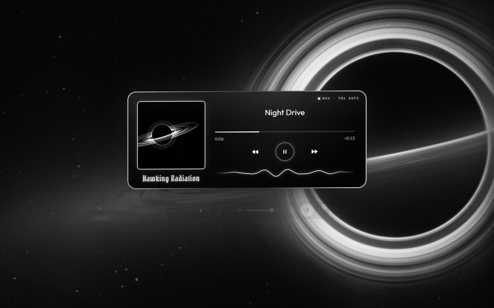
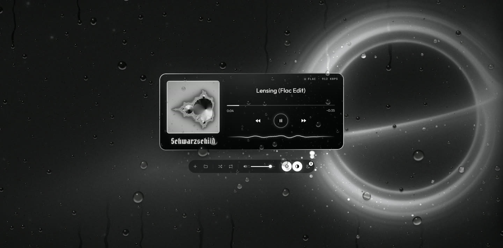
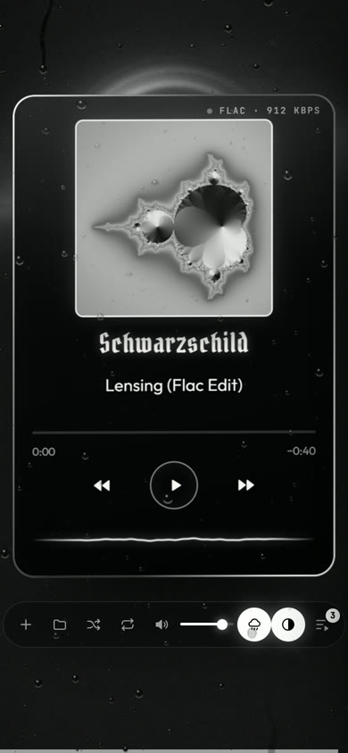

# Event Horizon

A monochrome music player that runs entirely in your browser. Drop in your own audio files and they play on a floating
glass card in front of a ray-traced black hole that pulses with the bass.

**[▶ Open the player](https://axel0806.github.io/event-horizon/)**



## Features

- **Bring your own music.** MP3, FLAC, M4A/AAC, WAV, OGG and Opus (whatever your browser can decode).
  Drag files or whole folders anywhere on the page, or use the file and folder pickers.
- **Reads your tags.** Title, artist, album and embedded cover art come from ID3v1/v2, FLAC, Ogg, MP4 and WAV/AIFF
  metadata. Untagged files fall back to "Artist - Title" filenames, and tracks without art get a generated cover.
- **A real black hole.** A WebGL ray tracer bends light around a Schwarzschild black hole. It has a gravitationally
  lensed accretion disk, a photon ring, Doppler beaming, bloom, lens softness and film grain, and it reacts to the music.
- **Rain on the glass.** An optional layer of water drops that refract the scene behind them, slide down and leave trails.
- **Live waveform**, a 3D card that floats and tilts with your cursor, and a format/bitrate badge.
- **Queue:** reorder by dragging, remove tracks, shuffle, and repeat the queue or one track.
- **Remembers everything.** Your queue (the audio itself), current track, position and settings survive reloads.
- **Works with your OS.** Media keys and lock-screen controls via the Media Session API.
- **Private by design.** Your files never leave your device. There's no server, account, tracking or upload.

<p>
  
  
</p>

## Keyboard shortcuts

| Key | Action | Key | Action |
|---|---|---|---|
| <kbd>Space</kbd> / <kbd>K</kbd> | Play / pause | <kbd>S</kbd> | Shuffle |
| <kbd>←</kbd> / <kbd>→</kbd> | Seek 5 s | <kbd>R</kbd> | Repeat: off → queue → track |
| <kbd>Shift</kbd> + <kbd>←</kbd> / <kbd>→</kbd> | Previous / next track | <kbd>M</kbd> | Mute |
| <kbd>↑</kbd> / <kbd>↓</kbd> | Volume | <kbd>W</kbd> | Rain on the glass |
| <kbd>0</kbd>–<kbd>9</kbd> | Jump to 0–90 % | <kbd>C</kbd> | Colour / monochrome artwork |
| <kbd>O</kbd> | Open files | <kbd>Q</kbd> / <kbd>Esc</kbd> | Toggle / close the queue |

## Running locally

There's no build step and there are no dependencies. Open `index.html` directly in a browser, or serve the folder:

```sh
python -m http.server 8000     # then open http://localhost:8000
```

## Browser notes

- Use a current version of Chrome, Edge, Firefox or Safari.
- **WebGL is needed for the animated black hole and the rain.** Some privacy-focused browsers turn it off by default.
  In **LibreWolf**, enable it under *Settings → LibreWolf → Enable WebGL*, or set `webgl.disabled` to `false` in
  `about:config`. Without WebGL the player still works, with a still image of the black hole.
- Which formats play depends on the browser's codecs. For example, some browsers can't play FLAC or Opus inside certain containers.
- Imported music is stored in your browser's IndexedDB. Use the trash icon in the queue to clear it.

## Project structure

```
index.html        markup, icon sprite, player card, dock, queue panel
css/styles.css    all styling (monochrome glass, 3D card, responsive)
js/app.js         playback, queue, import, Web Audio analyser, waveform, UI
js/space.js       WebGL black-hole ray tracer + post-processing (bloom, grain, rain fog)
js/rain.js        WebGL rain-on-glass overlay
js/tags.js        metadata and cover-art parser (ID3, FLAC, Ogg, MP4, RIFF/AIFF)
js/library.js     IndexedDB persistence
assets/           still renders of the black hole for browsers without WebGL
```

## License

Copyright © 2026 Axel Furtenbach. **All rights reserved.** See [LICENSE](LICENSE).
The source is published for viewing; reuse, modification or redistribution requires written permission.
Fonts (Outfit, Pirata One, JetBrains Mono) are served by Google Fonts under the SIL Open Font License.
